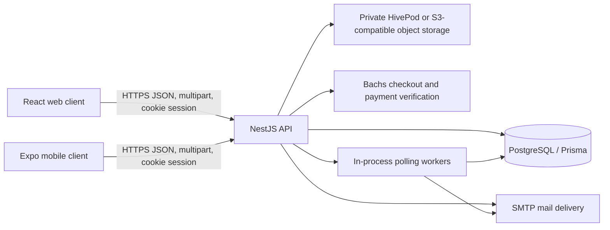
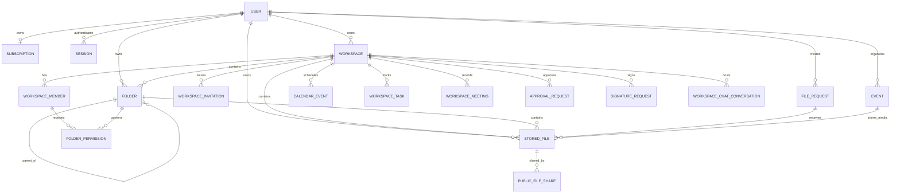

# IMARA Current System Audit

**Reviewed:** 2026-11-26

**Scope:** Read-only source review of the web client, NestJS API, Prisma schema
and migrations, existing mobile client documentation, tests, and local
development configuration. No application code, database, or production
configuration was changed.

This is the current-state companion to older planning documents in `docs/`.
Where those documents conflict with this audit, the checked-in controller,
service, DTO, Prisma schema, and migration source take precedence. This review
does not claim that a locally declared route is deployed or operational in
production.

## Executive summary

IMARA is a web-first document and workspace platform with an existing Expo
mobile client. The repository has three application surfaces:

| Area | Current implementation | Authority |
| --- | --- | --- |
| `apps/web` | React 18, TypeScript, Vite, React Router, TanStack Query, Tailwind | Browser UI and browser-only document/offline workflows |
| `apps/api` | NestJS 12, TypeScript, Prisma 7, PostgreSQL | Authentication, authorization, business rules, API, persistence and integrations |
| `mobile` | Separate Expo Router / React Native / TypeScript app | Native client; uses the existing API and account system |

The backend is not limited to the phase 1/2 feature set described by the
repository's older root/API README text. Source currently contains personal and
workspace productivity, calendar, meetings, forms, chat, events, approvals,
signatures, reminders, support, referrals, admin, billing and file-sharing
modules. Several are configuration-dependent and have not been verified against
a live production account.

The API uses cookie-backed server sessions, not bearer access tokens. Files are
stored outside PostgreSQL through a configured object-storage provider. The
backend has no Redis/BullMQ setup, no device-push registration API, no realtime
chat transport, no resumable upload protocol, and no server OCR engine. Four
in-process workers poll persisted email/reminder work.

## 1. Repository and application architecture

### Web application

- Entry: `apps/web/src/main.tsx`; router and protected-route behavior:
  `apps/web/src/App.tsx`.
- API client: `apps/web/src/lib/api.ts`; production API base is configured for
  `https://api.useimara.space/api/v1`, with `VITE_API_URL` and same-origin
  `/api/v1` alternatives for local builds.
- Auth state: `apps/web/src/auth/AuthProvider.tsx`. It checks `/auth/me`,
  signs out through `/auth/logout`, and handles expired sessions.
- Server-state cache: TanStack Query. The app sets a 20-second stale time and
  retries one network/server error.
- Vite development server proxies `/api` to the API service (default
  `127.0.0.1:3001`); running the web app alone does not start the API.

### API application

- Bootstrap: `apps/api/src/main.ts`; global prefix `/api/v1`.
- Module registration: `apps/api/src/app.module.ts`.
- Global request handling: Helmet, cookie parsing, credentialed CORS with an
  exact origin allow-list, origin check, DTO validation with unknown fields
  rejected, a global 100-requests-per-minute throttler, and an error-logging
  interceptor.
- Prisma/PostgreSQL connection: `apps/api/src/prisma/`. Prisma schema:
  `apps/api/prisma/schema.prisma`; ordered migrations are in
  `apps/api/prisma/migrations/`.
- The Nest modules are grouped by domain; calendar, productivity, meetings,
  forms, chat and workspace storage are composed under the workspace module.
  The source module registration, rather than the older conceptual 38-module
  inventory, is the accurate module map.

### Runtime and external architecture

There is no mobile-to-database or mobile-to-object-store credential access.
The API owns authorization and quota checks.

## 2. Frontend routes and application surfaces

There are 104 React Router declarations across the main router and nested admin
portal, counting aliases, redirects and wrappers rather than unique screens.
The source of truth is `apps/web/src/App.tsx` plus
`apps/web/src/pages/admin/AdminDashboard.tsx`.

### Public and account routes

Public pages include `/`, `/home`, `/about`, `/features`, `/docs`,
`/how-it-works`, `/pricing`, `/contact`, `/help`, `/faq`, `/terms`, `/privacy`,
`/security`, and `/accessibility`. Account routes include `/login`, `/register`,
`/forgot-password`, `/reset-password`, and `/verify-email`. Public token routes
cover invitation acceptance, event capture/gallery, shared-file access,
document response, file requests, and workspace forms.

### Authenticated personal routes

The protected app includes dashboard, files/folders, document studio, notes,
tasks, meetings, document tools, file requests, calendar, smart files,
favorites, trash, scanner, events, search, notifications, support, settings,
and billing/payment status. Aliases intentionally reuse canonical screens:
`/my-files`, `/all-files`, and `/folders` use the file browser; `/favorites` and
`/starred` use the favorites page; settings aliases share profile/settings
screens.

### Business workspace routes

Workspace routes cover shared storage, calendar, notes, tasks, meetings, forms,
private file deliveries, chat, signatures, approvals, reminders, team members,
invitations, member permissions, activity and roles. Workspace selection is
carried in the `workspace` query parameter and interpreted by the shell.

### Administration

`/admin/login` and `/admin/*` contain the separate privileged admin experience:
overview, users, business workspaces, storage/uploads, system health,
announcements and email campaigns, referrals, support, events, analytics/audit,
plans, subscriptions, payments, settings and role management. UI route gating
does not replace API permission checks.

### Data and interaction patterns

- Protected routes wait for auth bootstrap and preserve the requested return
  path when redirecting to login.
- App shell fetches workspace/account data, announcements and notifications.
  Notification refresh is periodic.
- Search indexing is partly browser-side: the shell downloads eligible files,
  extracts supported text locally and submits OCR/index text to the API. It
  skips unsupported formats and files above its configured size threshold.
- Forms use client validation, but API DTO validation and services are the
  authoritative enforcement layer.
- Frontend tests are focused unit tests, not comprehensive route or end-to-end
  workflow coverage.

For route-to-screen/action mapping and current mobile parity, see
[`IMARA_MOBILE_PARITY.md`](https://github.com/fitaccessng/imara_mobile/blob/main/IMARA_MOBILE_PARITY.md)
and
[`PAGE_PARITY_CHECKLIST.md`](https://github.com/fitaccessng/imara_mobile/blob/main/PAGE_PARITY_CHECKLIST.md)
in the separate mobile repository.

## 3. Feature inventory and workflow map

The table classifies functionality evidenced in the current UI/API source.
“Code-backed” means routes and implementation exist; it does not prove a live
provider or production deployment is healthy.

| Feature | What users can do | Access / enforcement | API and persistence | Status / limits |
| --- | --- | --- | --- | --- |
| Account lifecycle | Register, verify by link/code, sign in/out, recover/change password, list/revoke sessions, edit profile | Public auth flows or current session; server guard | Auth/profile controllers; `User`, `Session`, verification/reset token models | Code-backed; production mail delivery and native cookie behavior require live/device verification |
| Personal files and folders | Browse, upload, download, organize, favorite, soft-delete, restore/permanently delete, scan-upload, set expiry, save OCR text | Current user ownership, quota, file status and folder checks | Storage controller/service; `Folder`, `StoredFile`, `Subscription` | Code-backed; no `FileVersion` model; personal file rename/move endpoints are absent |
| Search and smart organization | Search file/folder metadata, retrieve smart library/duplicates, change categories/tags, submit extracted text | Authenticated and owner/workspace scoped | Storage and workspace-storage endpoints; `StoredFile` metadata and `ocrText` | API supports metadata organization; no server OCR engine and no duplicate-delete route |
| Favourites and recycle bin | Favorite/unfavorite files/folders, list trash, restore/permanently delete files | Owner / authorized workspace path | Storage routes and `Folder`/`StoredFile` flags/timestamps | File trash exists; folder recycle-bin parity is limited |
| Sharing and file requests | Create/list/revoke public file links; create/list/revoke upload requests; public recipients view/download/upload | Opaque token hashes; API checks resource and upload ownership/quota | File-share/file-request services; `PublicFileShare`, `FileRequest`, `StoredFile` | Code-backed; public bearer links are intentionally token-based |
| Events and galleries | Create/manage events, rotate capture/gallery tokens, accept public media, configure private/link/passcode gallery, unlock and download media | Event owner for management; token/grant for public flows; upload limits and quotas | Event controller/service; `Event`, `EventGalleryGrant`, `StoredFile` | Code-backed; object storage/provider availability must be configured |
| Document Studio/forms | Create/edit/publish/share documents/forms, collect responses and uploads, view responses | Document owner/workspace authorization; public tokens for response endpoints | Documents/forms controllers; personal/workspace document and form models | Code-backed. This is a form/response workflow, not a general cloud Word editor API |
| Document preview/editing/tools | Browser previews; spreadsheet editing, PDF notes and lightweight text/package editing; client-side conversions | Browser reads/writes through protected file APIs | Client libraries and file-content endpoints | Browser-side and format-limited; conversion fidelity varies, no server document-conversion service |
| Scanner/OCR | Browser/native capture and scan upload; browser text extraction can be saved as OCR text | API ownership/quota checks; local camera permissions | `/files/scan`, OCR-text endpoints; `StoredFile.uploadSource`/`ocrText` | Scan upload exists; backend OCR processing/engine is not implemented |
| Calendar/reminders | Personal/workspace calendar CRUD, event tags/reminder schedules, workspace reminders and completion/cancel | Authenticated; workspace membership/role checks | Calendar/reminder controllers and polling workers; `CalendarEvent`, reminder dispatch/recipient models | Code-backed; email depends on SMTP. No external calendar sync integration identified |
| Notes/tasks/meetings | Personal and workspace notes/tasks; meeting transcript/summary/decisions/action items; action item to task | User ownership or workspace scope | Notes/productivity/meetings controllers; personal/workspace model variants | Code-backed. Meeting transcription is not automatic; audio is attached/recorded and transcript is user-entered |
| Workspace collaboration | Manage workspace, invite/remove/suspend/restore members, roles, folder grants/restrictions, activity and notifications | Server-side owner/admin/member and folder-rule checks | Workspace controllers/services; `Workspace`, `WorkspaceMember`, `WorkspaceInvitation`, `FolderPermission`, `AuditLog` | Code-backed; role-specific live integration verification remains |
| Workspace chat | Discover members/files, create/open direct conversations, list/send messages | Workspace/member permissions | REST chat endpoints; conversation/message models | No WebSocket/SSE; clients must poll or refresh |
| Approvals | Templates, requests, attachments, comments, decisions, resubmit/cancel and activity | Workspace access and approver assignment; API owns transitions | Approval services; template/request/step/approver/activity/attachment models | Code-backed; live multi-role workflow not established by unit tests alone |
| Signatures | Create requests, inspect source/final document, sign/decline/cancel | Workspace membership and signer authorization | Signature services; request/signer models and stored files | Code-backed; legal validity and production key/identity assurance are not assessed here |
| Notifications/announcements | List/mark individual notifications and announcements read | Recipient or workspace member | Notification/announcement endpoints and delivery models | No device-token registration, push delivery API, read-all route or remote push integration |
| Billing/subscriptions | Read plans/subscription, initiate Bachs checkout, read payment attempts/status, receive provider webhook, admin verify payment | Authenticated user; provider verification/server reconciliation | Billing, plans and admin routes; `Subscription`, `PlanCatalogue`, `PaymentAttempt` | Checkout integration exists; actual live payment completion depends on Bachs configuration and is not production-verified |
| Referrals | Read referral status/promotion; admin controls program config | Authenticated user / platform-admin permission | Referral routes; `ReferralReward`, `ReferralProgramConfig` | Code-backed; rewards are storage entitlement, not an external payment |
| Support | Create/list/view tickets and send messages; support agents manage admin queue | Customer ownership; admin support permission | Support controller/service; support ticket/message models | Code-backed. Public contact page does not itself provide a configured public contact inbox |
| Platform admin | Manage users, platform admins, plans, payments, announcements, email campaigns, support, events, audit and analytics | Session plus active platform-admin profile and route-specific permission | Admin controller/service, guards and admin audit log | Code-backed, privileged; separate from customer/workspace roles |

## 4. Backend modules, controllers and API catalogue

All API paths are under `/api/v1`. There are 267 HTTP decorator occurrences
across the API controller source (aliases and repeated personal/workspace route
patterns are included in this count). The exact paths and methods are grouped in
[`API_INVENTORY.md`](https://github.com/fitaccessng/imara_mobile/blob/main/API_INVENTORY.md);
controllers and DTOs
listed below are the authoritative endpoint contracts.

| Domain | Controller/source | Implemented route families |
| --- | --- | --- |
| Health | `health.controller.ts` | `GET /health`, `/health/ready` |
| Auth/profile | `auth/auth.controller.ts`, `auth/profile.controller.ts` | Register/login/logout, email verification link/code, resend, forgot/reset link/code, change password, sessions, profile, subscription and dashboard summary |
| Billing/plans | `billing/billing.controller.ts`, `subscriptions/plan-catalogue.controller.ts` | Plan catalogue; checkout, payment history/status and provider webhook |
| Personal storage | `storage/storage.controller.ts` | Files, search, favorites, smart library, duplicates, trash, upload/scan/drafts/download/content/expiry/OCR, folder tree/CRUD/move |
| Shares/requests | `storage/file-shares.controller.ts`, `storage/file-requests.controller.ts` | Personal/workspace share CRUD, public share metadata/download, upload request lifecycle/public upload |
| Workspace | `workspaces/workspaces.controller.ts`, `workspaces/workspace-storage.controller.ts` | Workspace/member/invitation/permission/activity/notification lifecycle; shared files/folders/storage/search/uploads/downloads/deliveries |
| Calendar/productivity/chat | `workspaces/calendar.controller.ts`, `productivity.controller.ts`, `workspace-chat.controller.ts` | Personal/workspace calendar CRUD; workspace notes/tasks; chat members/files/conversations/messages |
| Meetings/forms | `meetings/meetings.controller.ts`, `forms/workspace-forms.controller.ts` | Personal/workspace meetings and action-item task conversion; workspace forms, public responses and uploads |
| Events | `events/events.controller.ts` | Authenticated event management/media plus public capture, gallery, passcode unlock and media download |
| Documents | `documents/documents.controller.ts` | Personal documents, responses, share/revoke and public response/sign routes |
| Workflow | `approvals/approvals.controller.ts`, `signatures/signatures.controller.ts`, `reminders/reminders.controller.ts` | Approval templates/requests/decisions/comments; signature request and signer actions; reminder create/update/complete/cancel |
| Notifications/support/referrals | `notifications/`, `announcements/`, `support/`, `referrals/`, `insights/` | Personal notifications and announcements; customer support tickets; referral status/promotion; weekly insights |
| Admin | `admin/admin.controller.ts` | Platform-admin access, users/businesses, operational metrics, support, payments, plans, announcements/email campaigns, security/audit functions |

### Request, response and error contracts

- `ValidationPipe` is global and rejects non-whitelisted request fields. Each
  controller method binds typed DTOs from its adjacent `*.dto.ts`.
- Multipart upload uses a single `file` field per request; the server enforces
  per-plan file limits (100/250/500 MiB for Free/Pro/Business in current
  configuration) plus quota and workspace rules.
- File downloads are streamed by authenticated API routes. Raw object keys are
  not client-facing API identifiers.
- Service methods return route-specific JSON objects; `204` is used for
  successful deletes where declared. Errors are Nest HTTP exceptions and pass
  through the API error-logging interceptor.
- A complete OpenAPI document or a single generated endpoint-by-endpoint
  request/response/error schema was not found. The route inventory and DTO files
  are source-complete, but response fields and failure examples still need to be
  transcribed or generated before treating `docs/API_ENDPOINT_DOCUMENTATION.md`
  as exhaustive. That older file explicitly mixes planned endpoints with
  implemented ones.
- `/auth/refresh` and a bearer-token contract are not implemented. Mobile should
  use the existing cookie session, not assume a refresh route.
- The source and older docs disagree about the resend-verification auth
  requirement and token-based password-reset shape. Controller/DTO behavior is
  authoritative; the six-digit `verify-email-code` and `reset-password-code`
  flows are the native-compatible paths documented by the mobile audit.

### Implemented route list

The following is the source-declared route surface, grouped by controller. Paths
are relative to `/api/v1`; method/path parameters are part of the contract.
Request fields are declared in the named controller's DTO file; response shapes
are constructed by the controller/service and are not uniformly documented in
one schema.

| Controller | Method and path |
| --- | --- |
| Health | `GET /health`; `GET /health/ready` |
| Auth | `POST /auth/register`, `/auth/login`, `/auth/verify-email`, `/auth/verify-email-code`, `/auth/resend-verification`, `/auth/forgot-password`, `/auth/reset-password`, `/auth/reset-password-code`, `/auth/logout`, `/auth/change-password`; `GET /auth/me`, `/auth/sessions`; `DELETE /auth/sessions/:id` |
| Profile | `GET /users/me` and `/profile`; `PATCH /users/me` and `/profile`; `GET /subscription`, `/dashboard/summary` and `/dashboard` |
| Billing | `POST /billing/checkout`, `/billing/webhook`; `GET /billing/payments`, `/billing/payments/:checkoutId` |
| Plan catalogue | `GET /plans` |
| Personal storage | `GET /files`, `/files/unindexed`, `/search`, `/files/favorites`, `/folders/favorites`, `/files/smart-library`, `/files/duplicates`, `/files/trash`, `/files/:id/download`, `/folders`, `/folders/tree`, `/folders/:id`; `POST /files`, `/files/editor-drafts`, `/files/scan`, `/files/:id/restore`, `/folders`, `/folders/:id/move`; `PATCH /files/:id/organization`, `/files/:id/expiry`, `/files/:id/ocr-text` (`PUT`), `/files/:id/favorite`, `/folders/:id/favorite`, `/files/:id/content`, `/folders/:id`; `DELETE /files/:id`, `/files/:id/permanent`, `/folders/:id` |
| Workspace storage | Under `/workspaces/:workspaceId`: `GET /storage`, `/files/unindexed`, `/search`, `/folders`, `/folders/:folderId`, `/file-deliveries`, `/file-deliveries/:deliveryId/download`, `/files/:fileId/download`; `POST /folders`, `/files`, `/files/editor-drafts`, `/files/scan`, `/files/:fileId/send`, `/files/:fileId/move`; `PATCH /folders/:folderId`, `/files/:fileId/content`, `/files/:fileId`; `PUT /files/:fileId/ocr-text`; `DELETE /folders/:folderId`, `/files/:fileId` |
| File shares | `POST`, `GET`, `DELETE /files/:fileId/shares[/:shareId]`; workspace equivalents under `/workspaces/:workspaceId/files/:fileId/shares[/:shareId]`; `GET /public-shares/:token`, `/public-shares/:token/download` |
| File requests | `POST`, `GET /file-requests`; `DELETE /file-requests/:id`; `GET /file-requests/public/:token`; `POST /file-requests/public/:fileRequestToken/uploads` |
| Workspaces | `GET`, `POST /workspaces`; `GET`, `PATCH /workspaces/:workspaceId`; `GET /workspaces/:workspaceId/my-folders`, `/members`, `/members/:memberId`, `/members/:memberId/activity`, `/invitations`, `/activity`, `/notifications`; `POST /workspaces/:workspaceId/invitations`; `POST /invitations/:token/accept`; `POST /workspaces/:workspaceId/invitations/:invitationId/resend`; `DELETE /workspaces/:workspaceId/invitations/:invitationId`; `PATCH /workspaces/:workspaceId/members/:memberId`; `POST /workspaces/:workspaceId/members/:memberId/suspend`, `/restore`; `DELETE /workspaces/:workspaceId/members/:memberId`; `GET`, `PUT /workspaces/:workspaceId/members/:memberId/permissions`; `GET`, `PUT /workspaces/:workspaceId/folders/:folderId/permissions`; `DELETE /workspaces/:workspaceId/folders/:folderId/permissions/:permissionId`; `POST /workspaces/:workspaceId/folders/:folderId/permissions/preview`; `POST /workspaces/:workspaceId/notifications/:notificationId/read` |
| Calendar | `GET`, `POST /calendar/events`; `PATCH`, `DELETE /calendar/events/:eventId`; workspace equivalents under `/workspaces/:workspaceId/calendar/events[/:eventId]` |
| Workspace productivity | Under `/workspaces/:workspaceId`: `GET`, `POST /notes`, `PATCH`, `DELETE /notes/:noteId`; `GET`, `POST /tasks`, `PATCH`, `DELETE /tasks/:taskId` |
| Meetings | Personal and workspace equivalents: `GET`, `POST /meetings`; `GET`, `PATCH`, `DELETE /meetings/:id`; `POST /meetings/:id/action-items/:actionItemId/task` |
| Workspace chat | Under `/workspaces/:workspaceId/chat`: `GET /members`, `/files`, `/conversations`; `POST /direct`; `GET`, `POST /conversations/:conversationId/messages` |
| Workspace forms | Under `/workspaces/:workspaceId/forms`: `GET`, `POST /`; `GET`, `PATCH`, `DELETE /:formId`; `POST`, `DELETE /:formId/share`; `GET /:formId/responses`; public `GET /public-forms/:token`, `POST /public-forms/:token/responses`, `/public-forms/:token/questions/:questionId/uploads` |
| Events | `POST`, `GET /events`; `GET /events/capture/:token`, `/events/gallery/:token`, `/events/gallery/:token/media/:mediaId/download`, `/events/:id/media`, `/events/:id/media/:mediaId/download`, `/events/:id`; `POST /events/capture/:token/uploads`, `/events/gallery/:token/unlock`, `/events/:id/rotate-tokens`; `PATCH`, `DELETE /events/:id` |
| Approvals | Under `/workspaces/:workspaceId/approvals`: `GET`, `POST /templates`; `PATCH /templates/:templateId`; `GET`, `POST /`; `GET /:requestId`; `POST /:requestId/decision`, `/comments`, `/resubmit`, `/cancel` |
| Signatures | Under `/workspaces/:workspaceId/signatures`: `GET /sources`, `/members`, `/`, `/:requestId`, `/:requestId/document`, `/:requestId/final`; `POST /`, `/:requestId/sign`, `/:requestId/decline`, `/:requestId/cancel` |
| Reminders | Under `/workspaces/:workspaceId/reminders`: `GET`, `POST /`; `PATCH /:reminderId`; `POST /:reminderId/complete`, `/:reminderId/cancel` |
| Documents | `GET`, `POST /documents`; `GET /documents/:id`, `/documents/:id/responses`; `PATCH`, `DELETE /documents/:id`; `POST`, `DELETE /documents/:id/share`; public `GET /public-documents/:token`, `POST /public-documents/:token/responses`, `/public-documents/:token/sign` |
| Notes and tasks | Personal `GET`, `POST /notes`, `GET`, `PATCH`, `DELETE /notes/:id`; `GET`, `POST /tasks`, `GET`, `PATCH`, `DELETE /tasks/:id` |
| Notifications | `GET /notifications`; `POST /notifications/:notificationId/read` |
| Announcements | `GET /announcements`; `POST /announcements/:id/read` |
| Referrals | `GET /referrals/me`, `/referrals/promotion` |
| Support | `POST`, `GET /support/tickets`; `GET /support/tickets/:id`; `POST /support/tickets/:id/messages` |
| Insights | `GET /insights/weekly` |
| Admin | Under `/admin`: `GET /me`, `/overview`, `/storage-inventory`, `/upload-monitoring`, `/system-health`, `/analytics`, `/plans`, `/referral-program`, `/subscriptions`, `/payments`, `/platform-admins/permissions`, `/platform-admins`, `/announcements`, `/announcements/recipients`, `/email-composer/recipients`, `/email-composer/campaigns/:id`, `/users`, `/users/:id`, `/businesses` (`/workspaces` alias), `/businesses/:id` (`/workspaces/:id` alias), `/events`, `/support-tickets`, `/support-agents`, `/support-tickets/:id`, `/audit-logs`; `PATCH /referral-program`, `/plans/:plan`, `/platform-admins/:userId`, `/announcements/:id/archive`, `/announcements/:id/restore`, `/users/:id/status`, `/support-tickets/:id`; `POST /payments/:checkoutId/verify`, `/announcements`, `/email-composer/campaigns/:id/resend`, `/email/send` (`/email-composer/send` alias), `/announcements/:id/retry-email`, `/users/:id/password-reset`, `/users/:id/verification-email`, `/support-tickets/:id/messages`; `DELETE /users/:userId/sessions/:sessionId` |

Use each listed controller and DTO file for exact query/body fields and its
service for output shape and state changes; the list intentionally does not
invent a common response envelope where the API has no uniform one.

## 5. Authentication, users and permissions

### User lifecycle

1. Registration creates the user and Free subscription and can create a
   business workspace/membership for the business registration path.
2. Verification is delivered by SMTP or development-only console delivery.
   Link and six-digit code routes exist.
3. Login verifies the password and creates a random opaque session value. Only
   its hash is persisted; the raw session value is returned as an HttpOnly
   cookie, not a JSON bearer token.
4. Protected requests use the session cookie. `SessionGuard` rejects missing,
   expired, revoked or inactive sessions and updates last-seen data.
5. Logout and session revocation invalidate server-side sessions. Password
   changes/recovery revoke sessions per service behavior.
6. Forgot/reset routes avoid account-disclosure responses and use hashed,
   single-use, time-limited tokens or OTPs.

Passwords are hashed with Argon2id. Token and session digests are stored rather
than raw secrets. Cookie flags are environment-controlled; production must use
secure HTTPS cookies and the deployment's exact origin policy.

### Authorization model

- `UserRole`/`PlatformAdminProfile` control platform-wide admin eligibility.
  Platform admins also have a domain permission role; only `SUPER_ADMIN`
  bypasses the permission catalog.
- `WorkspaceRole` is separate from plan entitlement. Workspace roles include
  owner/admin/manager/staff; member status is separately represented.
- Workspace membership is required for scoped operations. Folder grants and
  restrictions are evaluated server-side, including inheritance; ownership and
  admin privileges have explicit precedence in the permission service.
- A Free/Pro/Business subscription does not grant access to a workspace folder.
- Client route guards are UX only; the API controller/service is the security
  boundary.

## 6. Database and data relationships

PostgreSQL via Prisma is authoritative. The current schema contains **64 Prisma
models** and **45 migration directories**. Exact columns, PostgreSQL types,
nullable fields, primary/foreign keys, unique constraints and indexes are
defined in [`apps/api/prisma/schema.prisma`](../apps/api/prisma/schema.prisma)
and the migrations. The older `docs/DATABASE_SCHEMA.md` describes a different
proposed schema and must not be used to build against the current database.

### Model catalogue by domain

| Domain | Current Prisma models |
| --- | --- |
| Identity and admin identity | `User`, `PlatformAdminProfile`, `Session`, `VerificationToken`, `PasswordResetToken`, `PlatformAdminAuditLog` |
| Plan, billing and referrals | `Subscription`, `PlanCatalogue`, `PaymentAttempt`, `ReferralReward`, `ReferralProgramConfig` |
| Personal/workspace files | `Folder`, `StoredFile`, `PublicFileShare`, `FileRequest`, `Workspace`, `WorkspaceMember`, `WorkspaceInvitation`, `FolderPermission`, `FileDelivery` |
| Events and galleries | `Event`, `EventGalleryGrant` |
| Personal content/productivity | `PersonalDocument`, `PersonalDocumentResponse`, `PersonalNote`, `PersonalNoteAttachment`, `PersonalTask`, `PersonalTaskAttachment`, `PersonalMeeting` |
| Workspace content/productivity | `WorkspaceNote`, `WorkspaceNoteAttachment`, `WorkspaceTask`, `WorkspaceTaskAttachment`, `WorkspaceMeeting`, `MeetingActionItem`, `WorkspaceForm`, `WorkspaceFormResponse`, `WorkspaceFormUpload` |
| Calendar and reminders | `CalendarEvent`, `CalendarEventTag`, `CalendarReminderDispatch`, `CalendarReminderRecipient`, `Reminder`, `ReminderDelivery` |
| Communication and support | `WorkspaceChatConversation`, `WorkspaceChatMessage`, `Notification`, `PlatformAnnouncement`, `PlatformAnnouncementDelivery`, `SupportTicket`, `SupportTicketMessage` |
| Signatures and approvals | `SignatureRequest`, `SignatureSigner`, `ApprovalTemplate`, `ApprovalTemplateStep`, `ApprovalTemplateApprover`, `ApprovalRequest`, `ApprovalRequestStep`, `ApprovalRequestApprover`, `ApprovalActivity`, `ApprovalAttachment` |
| Administration/email delivery | `AuditLog`, `AdminEmailCampaign`, `AdminEmailCampaignDelivery` |

Notable schema facts:

- Personal and workspace entities share `User` and `StoredFile` identity but
  use explicit `workspaceId`/owner references and compound unique keys where
  cross-workspace references must be constrained.
- `Subscription` is one-to-one with `User`; `PlanCatalogue` defines plan
  entitlements/pricing; `PaymentAttempt` records provider checkout attempts.
- `StoredFile` records object key, original name, MIME type, size, status,
  source, quota reservation, category/tags, optional OCR text, deletion and
  expiry metadata. There is no `FileVersion` model.
- `Workspace` is owned by a user and relates to members, invitations, folders,
  files, logs, notifications and collaboration/productivity features.
- Forms/documents and public responses use hashed tokens; approval/signature
  workflow state is normalized into requests, steps, approvers/signers and
  activities.
- SMTP delivery and reminder work is persisted in delivery/outbox-style
  records. There is no generic `WebhookEvent` model in the current Prisma
  schema.

### Relationship diagram (domain-level)

The diagram omits secondary joins and delivery records for readability; the
Prisma schema is the complete relationship graph.

## 7. File storage, uploads and privacy

- PostgreSQL stores file metadata, relationships, and quota state; binary
  objects are delegated to `ObjectStorageService`.
- Current storage drivers are HivePod's authenticated HTTP storage service,
  S3-compatible object storage, and a local filesystem driver restricted to
  development/test.
- Production configuration requires a private storage service or S3-compatible
  provider. The API mediates downloads; object credentials must not be shipped
  to browser or native clients.
- Upload controllers stage multipart files and services check type/size,
  ownership, workspace access, quota reservation and storage completion.
  Event media paths additionally validate allowed media signatures.
- Quota tracks used and reserved bytes; file-request/workspace/event uploads
  apply owner/uploader plan rules as implemented by their services. Trash and
  deletion lifecycle should be read from service code, not inferred from older
  requirements docs.
- Personal file rename and move endpoints are absent. Folder move exists.
- There is no resumable/chunked upload route and no server file-version
  history model.
- Public shares/file requests/events/forms/documents rely on high-entropy
  opaque tokens whose hashes are stored. Public grants and passcode unlock
  tokens have expiry semantics where implemented.
- No malware-scanning provider or asynchronous antivirus job is registered in
  the current API source. Do not claim virus scanning is provided.

## 8. Integrations and background processing

| Integration/process | Evidence | Current behavior and failure boundary |
| --- | --- | --- |
| PostgreSQL | Prisma connection module and Compose config | Required for API startup and persisted state; no production DB was queried for this audit |
| HivePod storage | `storage/object-storage.service.ts` | Authenticated HTTPS storage service; requires deployment URL/token and available persistent storage |
| S3-compatible storage | `storage/object-storage.service.ts`, AWS SDK dependency | Optional provider driver; requires endpoint, bucket and secret credentials |
| Local object storage | Same service | Development/test only; rejected in production |
| SMTP | `auth/mailer.service.ts` | Sends verification, password reset, invitation and workflow/admin emails; console delivery is development/test only |
| Bachs payments | `billing/bachs-payment.service.ts` | Checkout and payment verification; sandbox/live mode and secrets are deployment-configured |
| Browser document/AI tooling | Web dependencies and feature code | Client-side preview/edit/OCR/conversion functions vary by format; not a backend processing service |
| Calendar sync | No provider client found | No Google/Apple/Outlook integration identified |
| Push notifications | No device-token route found | In-app notifications exist; remote mobile push is not implemented |
| Realtime chat | REST endpoints only | No WebSocket/SSE transport; mobile/web clients refresh or poll |
| Queueing | Four Nest workers use timers and persisted DB records | Announcement delivery, admin email campaign delivery, reminders and calendar reminders; no Redis/BullMQ queue is wired |

Worker state and recovery behavior is implemented in:
`apps/api/src/admin/announcement-delivery.worker.ts`,
`apps/api/src/admin/admin-email-delivery.worker.ts`,
`apps/api/src/reminders/reminder-delivery.worker.ts`, and
`apps/api/src/workspaces/calendar-reminder.worker.ts`. Multi-replica scheduling
and external monitoring have not been production-tested in this audit.

## 9. Security and performance assessment

### Controls confirmed in source

- Argon2id password hashing; opaque random session tokens and verification/reset
  tokens stored as digests.
- HttpOnly session cookie, revocable server-side session rows and expiry checks.
- Global DTO validation rejects extra properties and transforms declared DTOs.
- Helmet, exact configured CORS origins, origin rejection, and global
  throttling.
- API-side ownership/workspace checks, server-side folder permission evaluation,
  plan/quota enforcement, and privileged admin guards.
- Private object storage behind the API and token-based public access for
  explicitly shared resources.
- Password recovery response and one-time verification/reset semantics are
  implemented in auth services.

### Risks and limits (not confirmed exploitable vulnerabilities)

- The security-review specialist returned no finding for the reviewed changes;
  that result is not a full penetration test or a certification of the
  production deployment. No live production configuration, database, or
  external-provider account was inspected.
- The default throttler is process-local unless an external storage backend is
  configured. A multi-instance deployment may therefore not have a shared
  rate-limit counter.
- Four timer-based workers are in-process, not a durable distributed queue.
  Replica coordination, delivery latency, alerting and operational recovery
  need deployment-level verification.
- Public bearer tokens are present in URL paths for some workflows; reverse
  proxy/access analytics must redact those path segments. The API source
  avoids logging the raw tokens in its application flow.
- No server malware scanner is present. File signature/type checks reduce
  some upload ambiguity but are not antivirus scanning.
- Per-feature pagination and response contracts vary; large datasets may
  require limits/cursors, and clients must not invent pagination parameters.
- Browser OCR/indexing downloads file content to the client for extraction;
  performance and memory use depend on format and file size.
- There is no API-level OpenAPI contract or comprehensive end-to-end suite
  proving cross-user/workspace isolation on a deployed system.

No confirmed exploitable vulnerability is asserted by this source-level report.
The above items are configuration, availability, privacy, or verification risks
unless separately proven exploitable.

## 10. Feature implementation status

| Status | Features |
| --- | --- |
| Code-backed API and UI; live behavior not production-verified | Authentication/account, personal file/folder operations, workspace management, calendar, notes/tasks/meetings, forms/documents, event capture/gallery, file requests/shares, approvals, signatures, reminders, chat, notifications, support, referrals, plans/payments, admin |
| Implemented with limitations | Browser document conversion/editing, scanner/OCR text flow, mobile feature parity, online payment completion, local offline access |
| Frontend-only / client-side | Several previews, document conversions, OCR/indexing steps, scanner image preparation and offline UI/storage behavior |
| Not implemented in current backend | Bearer/refresh auth, mobile push-token registration, realtime chat, resumable uploads, file-version model, general server OCR engine, malware scanning provider, external calendar synchronization, mobile offline file-sync contract |
| Requires verification | Production SMTP and Bachs payment flow, production storage provider availability, multi-replica workers, native cookie persistence/revocation on physical iOS/Android, role-specific end-to-end permissions, live backups/restore and monitoring |

## 11. Mobile readiness and recommended integration

### Current mobile project

The mobile app is maintained in a separate Expo repository, not in the root npm
workspaces. It has Expo Router, TanStack Query, Zustand, typed API code, auth
screens, and additional feature screens.

The mobile architecture/parity documents report substantial API-connected
screens, but also mark important parity and device tests as partial or pending.
Read
[`ARCHITECTURE.md`](https://github.com/fitaccessng/imara_mobile/blob/main/ARCHITECTURE.md),
[`API_INVENTORY.md`](https://github.com/fitaccessng/imara_mobile/blob/main/API_INVENTORY.md),
and
[`IMARA_MOBILE_PARITY.md`](https://github.com/fitaccessng/imara_mobile/blob/main/IMARA_MOBILE_PARITY.md)
together;
do not treat a screen or bundle export as end-to-end validation.

### Reuse guidance

1. Keep `apps/api` as the sole business/data authority; mobile must call
   `/api/v1`, never PostgreSQL, HivePod or payment providers directly.
2. Preserve cookie-session authentication. The current mobile code uses native
   cookie handling and OS-protected storage; verify login, restart persistence,
   `/auth/me`, revocation, logout and 401 handling on both platforms before
   relying on it. Do not assume a bearer token or `/auth/refresh`.
3. Use server responses for workspace membership, permissions, quotas,
   entitlements and consequential approval/signature state.
4. Use multipart API uploads and authenticated downloads. Show server quota and
   validation errors. The API does not expose resumable uploads.
5. Use REST chat polling until a realtime contract exists. Push notifications
   require a backend device-token registration/delivery design first.
6. Treat local SQLite/secure file storage as a client cache/queue only. There
   is no general mobile offline file synchronization API; stale local permission
   data must not be treated as current access authority.
7. Decide separately on deep-link association, push service, background
   uploads, offline-access policy, pagination and native file preview before
   promising parity.

## 12. Known documentation drift

The following older docs are useful as planning history but contain
aspirational or superseded claims:

| Document | Drift discovered |
| --- | --- |
| `README.md`, `apps/api/README.md` | Phase 1/2 status says business workspaces, payments, notifications and admin are not implemented, while current code includes those modules |
| `docs/IMARA_PRODUCT_OVERVIEW.md` | Includes a 28-model/121-endpoint summary and proposed architecture that do not match the current schema/controller source |
| `docs/BACKEND_ARCHITECTURE.md`, `docs/BACKEND_MODULE_INVENTORY.md` | Describe Redis/BullMQ, malware/OCR/conversion workers and conceptual modules not wired in the current API |
| `docs/BACKGROUND_JOBS_AND_INTEGRATIONS.md` | Lists many planned jobs/providers; current source has four in-process polling workers and no malware/OCR provider |
| `docs/DATABASE_SCHEMA.md`, `docs/DATABASE_RELATIONSHIPS.md` | Describe tables such as `Profile`, `FileVersion`, `ShareLink`, `Invoice`, `WebhookEvent` that are not the current Prisma model set |
| `docs/API_ENDPOINT_DOCUMENTATION.md` | Explicitly includes planned routes and should not be used alone as an implementation contract |
| `docs/API_INTEGRATION_STATUS.md` | Says many routes/features are not provided although current controllers/services implement them |
| `docs/USER_ROLES_AND_PERMISSIONS.md`, `docs/BUSINESS_RULES.md` | Contains generic planned role/plan matrices that differ from current enums and service enforcement |

The current source references in this audit and the
[mobile API inventory](https://github.com/fitaccessng/imara_mobile/blob/main/API_INVENTORY.md)
should be used for implementation. A follow-up documentation pass should
reconcile the older docs rather than silently rely on their planned design
statements.

## 13. Verification performed

Commands were run from the repository root; no production endpoint was called.

| Check | Result |
| --- | --- |
| `npm run build -w @imara/web` | Passed |
| `npm run build -w @imara/api` | Passed; Prisma client generation completed |
| `npm test -w @imara/api` | Failed overall: 58 suites passed and 1 suite failed to compile because `scripts/create-platform-admin.ts` does not provide required `User.referralCode`; 417 tests passed |
| `npm test -w @imara/web` | Failed overall: 4 suites passed / 13 tests passed; `tests/idleTimeout.spec.ts` cannot resolve missing `src/auth/idleTimeout` |
| Live API / production provider / database check | Not performed |
| Full iOS/Android device workflow | Not performed as part of this audit |

The two test failures are existing source/test consistency issues; no source
changes were made to address them because the requested task is an audit.

## 14. Recommended mobile delivery roadmap

1. **Contract baseline:** publish OpenAPI or equivalent request/response/error
   schemas from the live controller/DTO set; reconcile endpoint docs and
   generate a stable API contract test suite.
2. **Native authentication proof:** validate the existing cookie strategy on
   physical/simulator iOS and Android, including session expiry/revocation and
   process restart; do not change backend auth without a reviewed migration
   plan.
3. **Core files:** finish file-list, folder, upload, download, preview, trash,
   search and permission error UX; explicitly account for absent personal file
   rename/move and version APIs.
4. **Workspace parity:** verify owner/admin/manager/staff access, invitations,
   folder grants/restrictions and workflow transitions with separate test
   accounts.
5. **Offline and notifications:** define a secure offline-access policy and
   queue contract; add server push registration only with an approved provider,
   token lifecycle and delivery design.
6. **Production readiness:** verify SMTP, object storage, Bachs sandbox/live
   behavior, backups/restoration, worker replica coordination, monitoring,
   pagination and real-device file transfer limits.

## 15. Source references

- Web route and protected-shell registration: `apps/web/src/App.tsx`
- Web shell and API client: `apps/web/src/components/AppShell.tsx`,
  `apps/web/src/lib/api.ts`, `apps/web/src/auth/AuthProvider.tsx`
- API entry/config/modules: `apps/api/src/main.ts`,
  `apps/api/src/app.module.ts`
- Auth/session: `apps/api/src/auth/`
- Storage/shares/requests: `apps/api/src/storage/`
- Workspace permissions/collaboration: `apps/api/src/workspaces/`
- Billing: `apps/api/src/billing/`, `apps/api/src/subscriptions/`
- Prisma models: `apps/api/prisma/schema.prisma`
- Database migrations: `apps/api/prisma/migrations/`
- Current mobile architecture and parity:
  [`ARCHITECTURE.md`](https://github.com/fitaccessng/imara_mobile/blob/main/ARCHITECTURE.md),
  [`API_INVENTORY.md`](https://github.com/fitaccessng/imara_mobile/blob/main/API_INVENTORY.md),
  [`IMARA_MOBILE_PARITY.md`](https://github.com/fitaccessng/imara_mobile/blob/main/IMARA_MOBILE_PARITY.md)
